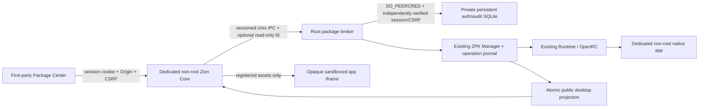

# Genesis 0.7 — native Package Center architecture

Genesis 0.7 reuses ZPK Foundation, Forge, Runtime, Manager, the App Registry and App
SDK. Installed applications remain native non-root OpenRC processes. The graphical
administrator facade is distinct from the existing read-only NAS APIs.



## Persistent platform

`zion-app-volume` runs during OpenRC boot, before the broker/Core. The only selected
volume comes from a canonical lowercase UUID in `/etc/zionos/apps-volume.uuid`, or
the explicit `opt/zionos/apps-uuid` QEMU firmware value when DMI identifies QEMU.
No value means degraded Package Center, not a RAM installation target.

The platform rejects duplicate UUID matches, mounted/system volumes, non-block
sources and unsupported filesystem types. This milestone supports preformatted ext4
only. It pins a read-only device descriptor, verifies UUID, records Linux disk sequence,
runs `e2fsck -f -n` through that descriptor, mounts read-only with `noload,nodev,nosuid,
noexec`, and validates a root-owned 0700 volume root and private marker:

```text
ZIONOS_APPS_V1
<configured-uuid>
```

It unmounts the read-only check, rechecks the pinned disk sequence, then mounts that
same descriptor read-write with `nodev,nosuid`. No formatter, partitioner or repair
executor exists in the platform CLI/broker. Physical devices are never used for tests.
Hotplug or I/O failures fail the boot step closed; physical hardware has not been
certified by the QEMU tests.

One volume is mounted under `/var/lib/zionos/platform` and supplies bind mounts:

| Volume subtree | Canonical destination | Access |
| --- | --- | --- |
| `apps` | `/opt/zionos/apps` | Root-controlled immutable versions/current references |
| `config` | `/etc/zionos/apps` | Runtime configuration; application grants remain explicit |
| `state` | `/var/lib/zionos/apps` | Dedicated package identities own their granted slots |
| `logs` | `/var/log/zionos/apps` | Existing Runtime logging policy |
| `registry` | `/var/lib/zionos/packages` | Root-only Manager database/journal |
| `uploads` | `/var/lib/zionos/uploads` | Dedicated Core user, 0700 bounded incoming files |
| root-private files | `/var/lib/zionos/platform` | Control SQLite, preview snapshots and curated catalog |

`zion-package-broker` requires networking and the volume service. Before starting its
Unix listener it invokes actual Manager reconciliation, restores locked service
identities/registrations through Runtime, starts configured autostart services and
publishes desktop entries. Missing/corrupt registry, account storage or required
runtime controls prevents the broker from starting. Core still starts and serves
read-only monitoring plus explicit unavailable/degraded diagnostics.

The old `ZIONOS-LAB-0.6.1` marker remains an inspection-protocol identifier, independent
of the OS version. The provisioning `--apply` executor remains disabled.

## Administrator authentication and transport

There is one **ZionOS system owner**, shared by the desktop and Package Center,
with no default password. First setup asks for a username/password in the trusted
localhost browser; there is no manual code. Core requires an exact local Origin
and localhost Host for enrollment; the ordinary network boundary also checks the
actual peer. The broker requires the dedicated Core peer and independently refuses
enrollment after an owner exists. SQLite's singleton owner row prevents replacement.
The first trusted local browser can claim an unconfigured system: do not expose
this development listener to LAN/public clients or untrusted host processes.

The existing private authentication database is reused, not duplicated by Package
Center. Legacy accounts gain username `admin` while keeping their Argon2 hash and
active sessions. New usernames are chosen at enrollment. The only implemented role
is administrator; standard-user creation and general RBAC remain future work.
The old root bootstrap/code APIs remain compatibility tools, not UI prerequisites.

Passwords are 12–128 bytes and stored as Argon2id PHC hashes, with independent random
128-bit salts, 19 MiB memory, two iterations and one lane. These parameters follow
the [OWASP minimum Argon2id configuration](https://cheatsheetseries.owasp.org/cheatsheets/Password_Storage_Cheat_Sheet.html).
The [RustCrypto 0.5.3 API](https://docs.rs/argon2/0.5.3/argon2/) is pinned in the lockfiles.
PHC parameters are checked before verification. Five failed attempts trigger a
persistent 60-second throttle. Passwords/setup codes are never written to audit logs.

Session cookies carry fresh 256-bit random tokens; only their SHA-256 digests are
stored. Session-bound CSRF tokens are held in the root-private database. Sessions
expire after 20 minutes idle or eight hours absolute; logout invalidates the server
record. At most eight sessions are retained. Cookies are host-only, `HttpOnly`,
`SameSite=Strict`, and scoped to `/api`, so package asset requests do not receive them.
The shared desktop session module keeps CSRF in memory; Package Center consumes
that session, with no password form or account management of its own. Logout is in
the system top bar; logout/expiry reloads the desktop into system login. Package
JavaScript in opaque frames receives no admin token. The desktop login/inert gate
is a UI boundary; existing local read-only NAS/health/discovery routes are deliberately
unchanged. Server-side authorization of actual package effects remains mandatory.

**This milestone supports local HTTP/QEMU localhost development only.** The cookie
does not use `Secure` on that HTTP development transport. The existing IP/Host allowlist
continues refusing remote LAN/public administration. HTTPS termination, Secure cookies,
trusted proxy configuration and LAN access are not implemented or silently enabled.
Do not publish/forward this development listener to LAN/public networks.

Every browser mutation requires an exact HTTP Origin matching Host; login/setup
require this check too. Authenticated mutations require the session, administrator
role and `X-Zion-CSRF`. JSON bodies/unknown fields are constrained. Desktop CSP denies
embedding, objects and foreign scripts; there are no CDN dependencies. The original
read-only monitoring routes remain restricted to local/QEMU clients.

## Unix authorization contract

Core runs under exclusive locked `zion-core`, not `nobody` or root. The root-owned
`/run/zionos/control` directory and mode-0660 socket admit that service group only.
The broker checks kernel `SO_PEERCRED` on **every connection**, requires the exact
Core UID, and independently verifies the supplied session and CSRF against its own
database before effects. Client-supplied authorization flags are not a capability.
Core also validates the session/role/CSRF before invoking privileged operations.
The client verifies that the listener's kernel UID is root. See the Linux
[Unix socket credential contract](https://man7.org/linux/man-pages/man7/unix.7.html).

Wire v1 is a marker byte, big-endian u16 version, big-endian u32 payload length and
strict tagged JSON. Request size is bounded to 16 KiB; replies to 2 MiB. Only preview
accepts one SCM_RIGHTS descriptor. Unknown operations/fields, incompatible versions,
extra/truncated descriptors and malformed framing are rejected. glibc/musl ancillary
length differences are handled explicitly; receivers set descriptor CLOEXEC.

The operation enum supports status/authentication, installed/catalog views, preview,
install/upgrade, lifecycle, bounded logs and operation progress. It has no shell,
arbitrary executable, URL download, mount, formatter or package lifecycle-hook action.
Local root console administration remains a separate trust boundary.

## Upload, preview and transactions

Core authenticates before reading upload content. It streams a raw `.zpk` into an
exclusively created, private persistent staging file, checks declared/actual bytes,
timeouts and free-space reserve, then sends a **read-only descriptor**, not a path.
The broker checks regular type, link count, owner, permissions, open mode and limits.
It copies a bounded snapshot into root-private storage and uses Foundation to inspect
manifest, archive paths/links, hashes and native contents without executing them.
Manager's resolver and OS/upgrade compatibility checks run before permission review.

The preview receipt binds snapshot digest, administrator session and ten-minute expiry.
Install verifies that binding/hash again and requires exact permission declarations
plus explicit trusted-local acknowledgement. No remote catalog is contacted. The
bundled `zion-hello` catalog entry is compiled through Forge during ISO staging;
local root may import additional inspected development archives.
The bounded local index (32 entries, at most 1 MiB) includes validated manifests
and stable package IDs for card details and installed-state matching. Older summaries
are enriched at startup from the same hash-checked local archives, without running
package contents. Browsing metadata creates no installation preview/snapshot; the
Install action still obtains a fresh validated, session-bound receipt and requires
the separate trust/permission confirmation.

`/etc/zionos/package-policy.json` optionally overrides validated defaults:

```json
{"max_upload":67108864,"reserve_bytes":67108864,"max_uploads":2}
```

Supported ranges: 128 KiB–64 MiB upload, 16 MiB–1 GiB reserve, one or two uploads.
There are at most four pending root snapshots. Archive expansion stays under the
existing Foundation limits. Install also reserves room for staging/immutable files.
App data quotas and aggregate usage accounting are not falsely reported as enforced.

Manager access is serialized across **reads and writes**, preventing status probes
from racing its process lock. Only one mutating operation runs at a time. Auth/progress
queries remain independent. Actual Manager checkpoints update durable operation state;
the UI shows phases, not fabricated percentages. Startup reconciliation preserves
the last committed version. Interrupted broker records remain explicitly diagnostic,
not falsely successful. Binary rollback does not reverse migrations/application data.
Uninstall preserves data/config/logs and reserved identities; purge is unavailable.

## Native desktop/security boundary

Successful Manager operations use the existing atomic App Registry. Launcher polling
discovers native entries without page reload; background-only packages expose no
invented desktop entry. Existing sandbox/CSP/source/session/nonce checks remain in
place; old assets/windows are revoked after upgrade/uninstall. Browser App SDK file
and native settings APIs remain unavailable: this package broker is not a general
application capability broker.

Runtime still uses dedicated non-root identities, Linux capability restrictions,
rlimits, Landlock and seccomp. Aggregate quotas, complete network/resource isolation,
publisher signatures, multi-user/RBAC/MFA/password-reset UI and production persistence
recovery policy remain outside this development milestone. Refer to
[Runtime boundaries](zpk/RUNTIME.md), [developer guide](GENESIS_07.md) and
[executed verification](GENESIS_07_VERIFICATION.md).
